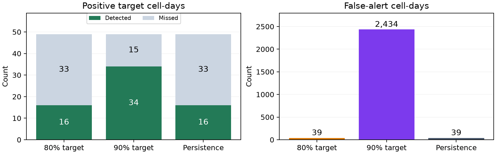
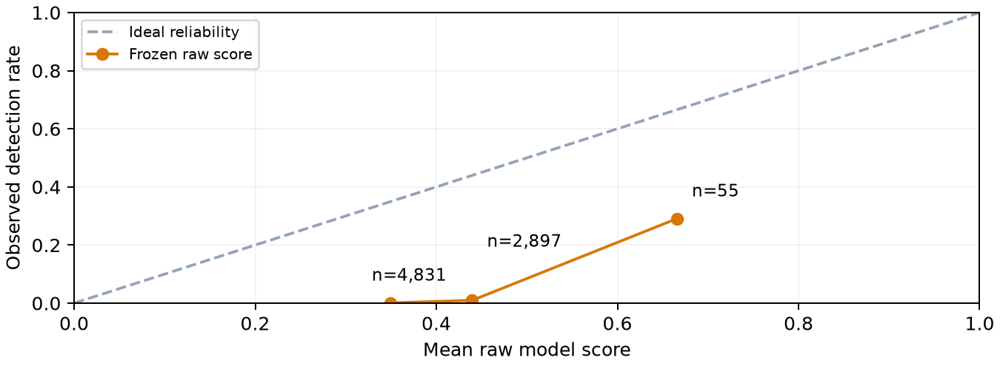
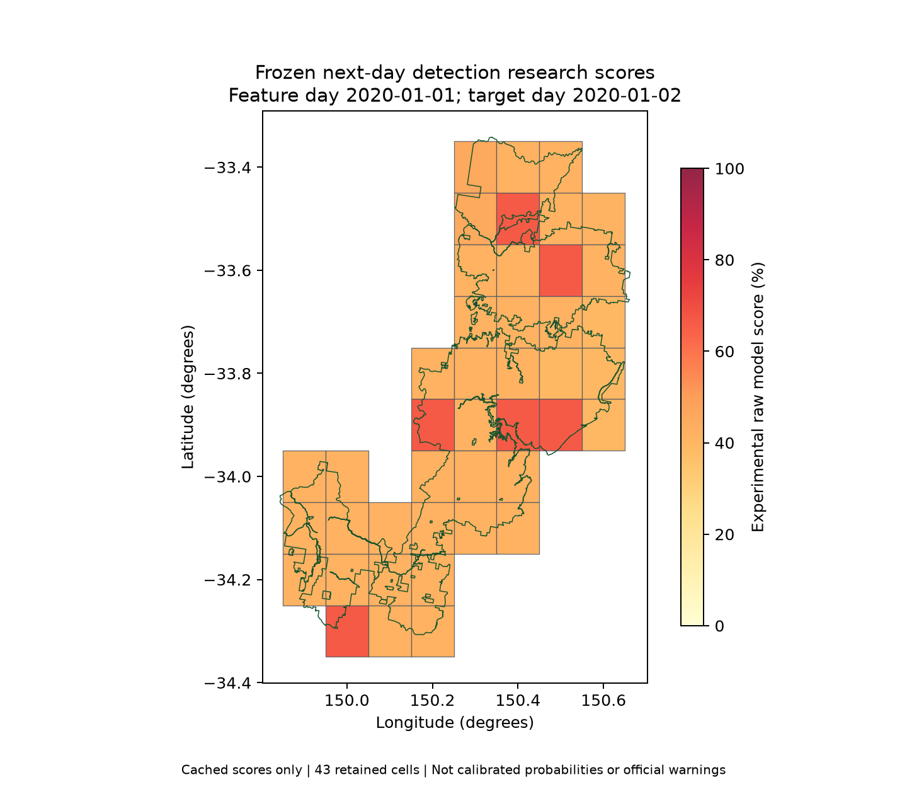

# Blue Mountains Bushfire Prediction

Group 3 Research Report - Integration Draft

AI-assisted integration draft; member and source-owner review pending

## Project scope and research question

Integration draft for Group 3. Author details, source-owner verification and member approval remain pending. This document is AI-assisted review material, not a declaration that every member completed or endorsed its contents.

### Executive overview

We investigated whether weather, terrain and observed current fire could support next-day satellite-detection research in Blue Mountains National Park. A revised reproducible ML workflow was completed, but its frozen final evaluation did not establish reliable warnings or calibrated fire probabilities. The contribution is a documented comparison and an explanation of its limitations.

### Research question and objectives

For each retained native weather-grid cell and completed UTC day, can learned scores identify eligible satellite fire detection on the next day better than prevalence and persistence references, and can a development-selected reminder policy transfer to later dates? The objectives were to audit the data interface, compare matched models, assess temporal stability and score reliability, freeze decisions and report one final evaluation transparently.

### Related work

XGBoost provides a method for modelling nonlinear feature relationships [1], while AP summarises ranking without conflating it with threshold accuracy [2]. The supplied Australian environmental-analytics paper motivates multi-source bushfire research [5]. Its task, sampling and reported metrics are not a direct benchmark for our cell-day next-day evaluation. Seb must confirm and extend the literature interpretation before submission.

### Changes from the original plan

The available data cover one season, so an independent later-season test was not possible. Fuel/vegetation inputs, Random Forest, new SHAP analysis, live inputs and operational deployment were not delivered. The revised method restricted inputs to those supported by the audit and used chronological rather than interleaved evaluation as its main evidence. These scope changes are recorded, not hidden by high within-season scores.

### Version and evidence boundary

The previous group study and revised study identify the same extended source table and overlapping 2019-20 dates/cells. A protected one-time release under a revised protocol is not a previously unknown dataset or independent-season replication. The legacy version remains preserved; the revised source commit, freeze and release are linked in the repository integration records.

## Data lineage, unit and limitations

| Source panel item | Recorded value |
| --- | --- |
| Rows and columns | 18,980 rows; 39 columns |
| Source and retained cells | 52 source; 43 retained |
| Feature-date coverage | 2019-07-01 to 2020-06-29 |
| Current model inputs | 16 core; 17 with same-day detection |
| Park-overlap rule | At least 10% |

### Supplied source lineage

| Dataset | Role recorded in the supplied preparation |
| --- | --- |
| NASA FIRMS VIIRS | Eligible next-day detection target and same-day fire flag |
| ERA5-Land | Retrospective hourly weather aggregated to daily summaries |
| Geoscience Australia SRTM | Park-portion elevation, slope and aspect summaries |
| NPWS estate and fire history | Park boundary/overlap and partial prescribed-burn exclusion |

The original source register, provenance, prepared tables, spatial files, preparation scripts and limited raw subset are retained with their attribution. Their bytes are checked against the group baseline. The public subset omits most original raw GIS/fire/weather inputs; the complete acquisition and spatial-label pipeline was not independently rerun during integration.

### Data interface and uncertainty

Data sources are joined by grid and UTC date. Weather represents the whole grid cell, whereas terrain and labels concern its park portion. Non-detection is not verified absence of fire, and known prescribed burns are only partially excluded. Zero-positive final months remain reported; adequate observation coverage requires data-owner confirmation.

Available columns are not automatically approved predictors. Long rainfall windows have incomplete early history and the initial dry-spell state lacks prior observations. These candidates were excluded; the core three-day window has a two-day fitting warm-up. Inputs describe completed days and retrospective archives, so actual publication latency and issue-time availability have not been validated [6].

Penelope is both the original data contributor and the current data contact for this revision. Her earlier data PR remains historically attributed to the same person. Source versions, licences, geometry, coverage and target construction still require her recorded review; no full acquisition or personal verification beyond the recorded evidence is claimed on her behalf.

## Study design and inputs

We built a research prototype for next-day eligible satellite fire detection in Blue Mountains National Park. The frozen model and its two development-selected recall policies did not establish reliable warning performance. The deliverable is an auditable ML comparison, not a deployed warning system or a validated ignition-probability map.

### Prediction unit and evidence

Each row is one retained ERA5-Land grid cell and one UTC feature day; the target is at least one eligible VIIRS detection on the following UTC day. Continuing fire counts as positive. Non-detection is not proof of no physical fire. Weather is aggregated over the grid cell, while terrain and labels concern its park portion; the group data owner must retain source and geometry documentation. ERA5-Land is retrospective reanalysis [6].

### Temporal separation

| Partition | UTC feature dates | Rows |
| --- | --- | --- |
| Training | 1 July to 8 December 2019 | 6923 |
| Gap | 9 to 15 December 2019 | 301 |
| Validation | 16 to 24 December 2019 | 387 |
| Gap | 25 to 31 December 2019 | 301 |
| Final holdout | 1 January to 29 June 2020 | 7,783 |

All cells from a date stayed together. The supplier's future-test boundary was preserved, with seven-day gaps rather than interleaved weeks [3]. At least 10% park overlap retained 43 cells. Rainfall warm-up excluded the first two feature days from fitting, leaving 6,837 training rows and 143 positive targets. Gaps reduce adjacency, not dependence between long-running fires.

### Reviewed inputs

The core has sixteen weather/terrain variables; the second version adds only the audited same-day fire_today flag. Target-day counts, labels, dates, grid identifiers and coordinates are excluded as predictors. Long rainfall/dry-history and other current-fire candidates were not enabled because their warm-up or semantics needed further treatment. Fuel-moisture imagery and NDVI were not implemented.

## Models and evaluation procedure

### Matched models and stopping

Training prevalence and persistence were explicit references. Logistic regression and XGBoost were each compared with sixteen and seventeen inputs on matched fitting/evaluation rows. Logistic scaling and balanced weights used training rows only. Tree fitting used training negatives divided by positives for class emphasis; calibration did not rebalance labels. XGBoost tests nonlinear thresholds/interactions [1], rather than guaranteeing better performance.

| XGBoost setting | Recorded value |
| --- | --- |
| Maximum depth | 3 |
| Learning rate | 0.05 |
| L2 leaf penalty | 5.0 |
| Row and feature subsampling | 0.8 and 0.9 |
| Early stopping | 25 rounds without AP improvement |
| Final 16 and 17 input tree counts | 6 and 8 |

Average precision (AP) was computed from raw scores using sklearn, and explicitly maximised for stopping [2]. The initial validation selected tree length and was development evidence. Later forward checks selected length on past inner data and refitted that fixed count before checking later dates. Missing-class windows remained visible; the dependent windows were not treated as independent replication.

### Probability and reminder decisions

A nondecreasing regularised sigmoid was fitted on base-model-excluded calibration rows, then checked on later dates, with seven-day gaps and no post-calibration base refit. The week-long design worsened later probability quality; the improving recent design had only one calibration and one assessment day. Calibration was therefore not adopted [4]. The highest calibration-only cutoff meeting each requested recall constraint was retained, with ties together.

| Development target | Exact raw cutoff | Comparison |
| --- | --- | --- |
| 80.0% | 0.6658568382263184 | >= |
| 90.0% | 0.4193871319293976 | >= |

The complete source, features, artifacts, thresholds and reporting rules were committed in freeze ef45cdf before one final release [7]. No final fitting, calibration or threshold search occurred. AP was primary; confusion counts, probability quality and alert burden were reported overall, without current detections, and for every calendar month.

## Final findings

The final period has 7,783 cell-days, 181 dates and 49 positive next-day targets (0.63%); these are not independent fires. Both frozen development recall targets failed to transfer [7].

| Frozen policy | TP | FP | FN | Recall | Precision |
| --- | --- | --- | --- | --- | --- |
| 80% target | 16 | 39 | 33 | 32.7% | 29.1% |
| 90% target | 34 | 2,434 | 15 | 69.4% | 1.4% |
| Persistence | 16 | 39 | 33 | 32.7% | 29.1% |

| Model at diagnostic 0.5 | AP | Recall | Brier |
| --- | --- | --- | --- |
| Training prevalence | 0.0063 | 0.0% | 0.0065 |
| Persistence | 0.0992 | 32.7% | 0.0093 |
| Logistic 16 | 0.0461 | 81.6% | 0.1319 |
| Logistic 17 | 0.2113 | 63.3% | 0.0391 |
| XGBoost 16 | 0.0219 | 57.1% | 0.1912 |
| XGBoost 17 | 0.1062 | 32.7% | 0.1511 |

Figure 1  Frozen-policy trade-off. Counts are cell-days, not incidents or staffing requirements. The development target is not a promise of final recall.

The prespecified logistic 17 comparison ranked better than XGBoost 17; this did not trigger a replacement or retuning. Without current detections, the higher cutoff found 0 of 33 positives; the lower found 18 with 2,395 false alerts. All months were retained, including zero-positive months with undefined AP/recall. A no-alert reference scored 99.37% accuracy while missing every positive.

## Reliability and implications

Figure 2  Fixed-bin reliability for the frozen raw score. Bin sizes and observed frequencies do not establish independent-event precision or calibrated percentages.

The raw scores overstate observed next-day detection frequencies. The small AP advantage over persistence does not establish practical warning benefit, and Brier/log loss measure overall probability quality rather than calibration alone. We did not fit a correction using final outcomes [4,7].

### Interpretation and recommendations

The evidence supports a research prototype, not operational dispatch or public risk percentages. False alerts could waste review capacity and erode trust; missed detections could create false reassurance. A future interface should retain human review, label score meaning, provenance and timing, and distinguish satellite non-detection from physical safety. Response capacity and the costs of false versus missed alerts require stakeholder agreement, not invented financial assumptions.

Transfer is limited by sparse early positives, changing prevalence, one supplied season, dependent cells/events, imperfect detection coverage and coarse spatial aggregation. Retrospective publication latency was not simulated. The related Australian multi-source study motivates environmental modelling, but its task, data and headline accuracy are not a like-for-like benchmark for our next-day AP evaluation [5].

Further work needs independent seasons/events, checked observation coverage, suitable fuel information and forecast-time data availability before calibration and response-policy validation. This exposed test must not become a tuning set. The ML contribution completes the auditable comparison; the group must still verify source/licence/map details, domain interpretation, citations, authorship and AI-use records before submission.

## Cached spatial illustration and use limits

Figure 3  First frozen feature day (1 January 2020), using original saved XGBoost 17 scores. Native grid cells extend outside the park. Colours are uncalibrated model scores, not ignition probabilities or official warnings.

The date was fixed as the first frozen feature date without inspecting outcomes. The drawing uses the receipt-matching prediction cache and supplied static geometry, not a new model prediction pass. Its provenance records the original score-cache hash. No observed outcomes are used to select the date or colour the cells.

The map illustrates the output unit and park geometry. It does not demonstrate reliable spatial warning performance, generalisation to unseen locations or continuous fire fronts. The old model's SHAP and illustrative map remain historical and are not relabelled as revised-model evidence.

### Decision consequences

Emergency services and land managers could face wasted review effort from false alerts, while misses or low scores could create false reassurance. Residents and councils could misinterpret percentage formatting as a validated probability. Any future use affecting communities or land-management choices would need appropriate consultation and governance; no such consultation or stakeholder endorsement is claimed.

## Group integration and assistance appendix

Engineering artifacts are available for review. Automated acceptance is recorded separately in the repository and does not establish personal understanding, peer approval or final submission readiness. The official deadline, confirmed author details and final group approval must be supplied by the group.

| Contact | Required final review |
| --- | --- |
| Kian | Explain and inspect the ML code, metrics, freeze and adverse findings |
| Chris | Confirm official requirements, authors and complete report consistency |
| Penelope | Confirm source rights, timing, labels, geometry and observation coverage |
| Seb | Check primary literature and stakeholder/ethical interpretation |

### Substantive AI assistance

Codex assisted with modelling code, explanations, experimental checks, integration, figures and report prose under Kian's direction. The following prompts are condensed English translations, not a verbatim transcript. Preserve the conversation and record real member changes/checks in the linked contribution and AI-use records.

| Prompt summary | Output and recorded verification |
| --- | --- |
| Reserve a final test; explain each ML step | Chronological protocol, data guards and baseline comparisons; synthetic checks |
| Compare models, temporal stability and probabilities | Matched models and development-only checks; calibration not adopted |
| Freeze both policies and evaluate once | Committed freeze, completed receipt and unchanged adverse final result |
| Integrate in five stages with detailed English commits | Baseline tag, migration inventory, guarded applications and clean-clone acceptance record |

Tool-assisted checks are not independent scientific replication or student sign-off. No final outcomes were used to retune this integration. New modelling requires independent evaluation data, while the submitted report must retain the failed probability/warning objectives and the limitations of the supplied evidence.

## References

1. Tianqi Chen and Carlos Guestrin. XGBoost A Scalable Tree Boosting System. 2016. [Source](https://arxiv.org/abs/1603.02754)
2. scikit-learn developers. Average precision score. 2026. [Source](https://scikit-learn.org/stable/modules/generated/sklearn.metrics.average_precision_score.html)
3. scikit-learn developers. Cross validation of time series data. 2026. [Source](https://scikit-learn.org/stable/modules/cross_validation.html#cross-validation-of-time-series-data)
4. scikit-learn developers. Probability calibration. 2026. [Source](https://scikit-learn.org/stable/modules/calibration.html)
5. Tanvi Jois and Hussain Ahmad and Fatima Noor and Faheem Ullah. Australian Bushfire Intelligence with AI Driven Environmental Analytics. 2026. [Source](https://arxiv.org/abs/2601.06105)
6. Copernicus Climate Change Service. ERA5 Land hourly data from 1950 to present. 2026. [Source](https://cds.climate.copernicus.eu/datasets/reanalysis-era5-land?tab=overview)
7. ENGG2112 project team. Blue Mountains frozen final temporal evaluation. 2026. [Source](https://github.com/nedavaskachristopher-jpg/Group-3-2112/blob/main/research/reports/final_holdout.md)

## Evidence and review records

[Final aggregate](../research/reports/final_holdout.json) | [Freeze](../research/reports/final_freeze.json) | [Integration](../docs/integration/README.md) | [Contributions](../team/CONTRIBUTIONS.md) | [AI record](ai_use_appendix.md)
