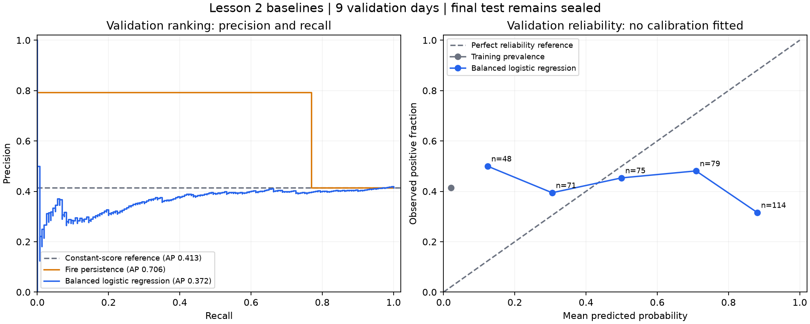

# Lesson 2 baseline results

Validation results only. The final test remains sealed.

Training used 6,837 rows after removing 86 warm-up rows, with 16 core inputs.
Training prevalence: 2.0916%. Validation: 387 rows across 9 UTC feature dates.

## Fixed diagnostic threshold: 0.5

| Method | AP | Precision | Recall | TP | FP | FN | TN | Brier | Alerts/day |
| --- | ---: | ---: | ---: | ---: | ---: | ---: | ---: | ---: | ---: |
| Training prevalence | 0.4134 | 0.00% | 0.00% | 0 | 0 | 160 | 227 | 0.3966 | 0.00 |
| Fire persistence | 0.7056 | 79.35% | 76.88% | 123 | 32 | 37 | 195 | 0.1783 | 17.22 |
| Balanced logistic regression | 0.3716 | 39.66% | 57.50% | 92 | 140 | 68 | 87 | 0.3649 | 25.78 |

Brier for persistence is the squared-error reference of its hard 0/1 outputs; these are not calibrated probability forecasts.



## Interpretation limits

- The 0.5 threshold is a fixed diagnostic reference, not an optimised warning rule.
- Balanced class weights are calculated from training labels only. They change the loss, not the number of data rows.
- Class weighting and the train-validation base-rate change mean logistic outputs are not established real-world probabilities.
- The persistence rule has access to current fire, while the conditions-only logistic model does not. This is a practical benchmark, not a controlled feature-matched comparison.
- The constant-score AP equals validation prevalence, although its predicted probability comes from training prevalence.
- The fire_today=0 subset retains negatives and positives. A next-day new detection is not proof of a new ignition.
- One short, dependent fire interval provides limited evidence; do not claim independent-season performance.
- No hyperparameter search, threshold optimisation, calibration fit or final-test evaluation was performed.

## Reproduce

```powershell
.\.venv\Scripts\python.exe -m bushfire_ml.baselines
```

Row-level validation predictions and the fitted pipeline remain under the ignored local data directory.
