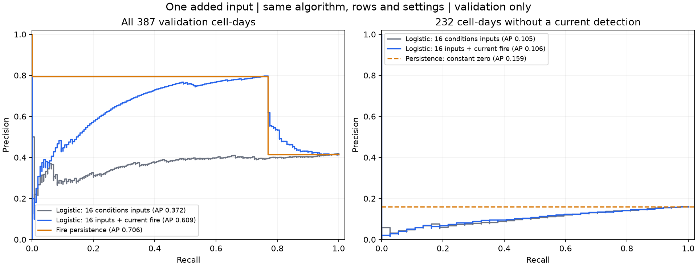

# Lesson 4: one added input

The only design change is adding the audited same-day `fire_today` flag. The model is refitted, so all learned weights may change.

Both logistic fits use 6,837 training rows, the same 387 validation rows and identical classifier settings. The fixed diagnostic threshold remains 0.5. No final-test evaluation or calibration fit.

## All validation rows

| Method | AP | Precision | Recall | TP | FP | FN | Brier | Alerts/day |
| --- | ---: | ---: | ---: | ---: | ---: | ---: | ---: | ---: |
| Logistic: 16 conditions inputs | 0.3716 | 39.66% | 57.50% | 92 | 140 | 68 | 0.3649 | 25.78 |
| Logistic: 16 inputs + current fire | 0.6090 | 59.05% | 77.50% | 124 | 86 | 36 | 0.2465 | 23.33 |
| Fire persistence | 0.7056 | 79.35% | 76.88% | 123 | 32 | 37 | 0.1783 | 17.22 |

## No current detection: 232 rows, 37 next-day positives

| Method | AP | Precision | Recall | TP | FP | FN | Brier | Alerts/day |
| --- | ---: | ---: | ---: | ---: | ---: | ---: | ---: | ---: |
| Logistic: 16 conditions inputs | 0.1046 | 5.79% | 18.92% | 7 | 114 | 30 | 0.4106 | 13.44 |
| Logistic: 16 inputs + current fire | 0.1059 | 1.82% | 2.70% | 1 | 54 | 36 | 0.2736 | 6.11 |
| Fire persistence | 0.1595 | 0.00% | 0.00% | 0 | 0 | 37 | 0.1595 | 0.00 |



## Interpretation limits

- The validation set has already guided development. This is a development comparison, not a final independent performance estimate.
- Check ranking and the fixed-threshold confusion counts separately. A higher AP does not guarantee fewer missed detections at threshold 0.5.
- Gains can be dominated by continuing fire. Keep the no-current-detection subset visible; new detections are not confirmed new ignitions.
- Current-day observations are assumed available after the UTC feature day ends. No following-day fire counts are inputs; archive publication latency remains a limitation.
- The 22 December zero-detection issue and all other original labels remain unchanged.
- Balanced class weights and temporal event-rate changes mean raw sigmoid percentages still require reliability assessment. No deployed warning threshold is chosen.
- Persistence is a hard binary comparator; its Brier value is a squared-error reference rather than proof of calibrated 0/100% probabilities.

## Reproduce

```powershell
.\.venv\Scripts\python.exe -m bushfire_ml.current_fire
```
