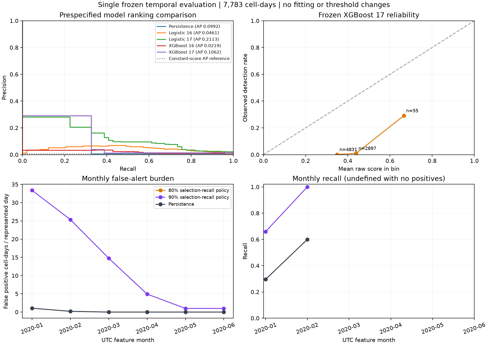

# Frozen final temporal evaluation

One authorised release of the protected retrospective temporal holdout. All models, both cutoffs and the evaluation rules were frozen and committed before outcomes were parsed. No fitting or threshold adjustment occurred.

Freeze commit: `ef45cdf63b570c01ce4c76659f3071e89ba29f5a`. Freeze manifest SHA256: `0134e05d862a83ebb1b9921a8288484e9b74d9fcfac121432e6366a55640c3db`.

UTC feature dates: 2020-01-01 to 2020-06-29; targets: 2020-01-02 to 2020-06-30.
Population: 7,783 cell-days, 181 dates, 43 cells; 49 positive cell-days (0.63%).

## Both frozen reminder policies

| Frozen policy | Exact cutoff | Precision | Recall | TP | FP | FN | Alerts/day | False alerts/day |
| --- | ---: | ---: | ---: | ---: | ---: | ---: | ---: | ---: |
| 80% selection-recall policy | 0.6658568382263184 | 29.1% | 32.7% | 16 | 39 | 33 | 0.30 | 0.22 |
| 90% selection-recall policy | 0.4193871319293976 | 1.4% | 69.4% | 34 | 2434 | 15 | 13.64 | 13.45 |
| Persistence | 0.5 | 29.1% | 32.7% | 16 | 39 | 33 | 0.30 | 0.22 |

Policy names refer to recall constraints on development selection rows. They do not guarantee final recall. Counts are cell-days, not independent fires, dispatches or staffing requirements. Cutoffs operate on uncalibrated scores and use inclusive comparisons.

## Prespecified model comparison

| Model (diagnostic cutoff 0.5) | AP | Precision | Recall | TP | FP | FN | Accuracy | Brier | Log loss |
| --- | ---: | ---: | ---: | ---: | ---: | ---: | ---: | ---: | ---: |
| Training prevalence | 0.0063 | 0.0% | 0.0% | 0 | 0 | 49 | 99.4% | 0.0065 | 0.0454 |
| Persistence | 0.0992 | 29.1% | 32.7% | 16 | 39 | 33 | 99.1% | 0.0093 | N/A |
| Logistic 16 | 0.0461 | 2.7% | 81.6% | 40 | 1432 | 9 | 81.5% | 0.1319 | 0.4857 |
| Logistic 17 | 0.2113 | 8.7% | 63.3% | 31 | 326 | 18 | 95.6% | 0.0391 | 0.1718 |
| XGBoost 16 | 0.0219 | 1.8% | 57.1% | 28 | 1527 | 21 | 80.1% | 0.1912 | 0.5732 |
| XGBoost 17 | 0.1062 | 11.1% | 32.7% | 16 | 128 | 33 | 97.9% | 0.1511 | 0.4904 |

Frozen XGBoost 17 minus persistence AP difference: 0.0069. This descriptive difference is not a statistical superiority claim. Accuracy is secondary and can be dominated by negative rows.

## Cells without current detections

7,728 cell-days with 33 positive targets (0.43%); both target classes are retained where present.

| Frozen policy | Exact cutoff | Precision | Recall | TP | FP | FN | Alerts/day | False alerts/day |
| --- | ---: | ---: | ---: | ---: | ---: | ---: | ---: | ---: |
| 80% selection-recall policy | 0.6658568382263184 | 0.0% | 0.0% | 0 | 0 | 33 | 0.00 | 0.00 |
| 90% selection-recall policy | 0.4193871319293976 | 0.7% | 54.5% | 18 | 2395 | 15 | 13.33 | 13.23 |
| Persistence | 0.5 | 0.0% | 0.0% | 0 | 0 | 33 | 0.00 | 0.00 |

| Model (diagnostic cutoff 0.5) | AP | Precision | Recall | TP | FP | FN | Accuracy | Brier | Log loss |
| --- | ---: | ---: | ---: | ---: | ---: | ---: | ---: | ---: | ---: |
| Training prevalence | 0.0043 | 0.0% | 0.0% | 0 | 0 | 33 | 99.6% | 0.0045 | 0.0376 |
| Persistence | 0.0043 | 0.0% | 0.0% | 0 | 0 | 33 | 99.6% | 0.0043 | N/A |
| Logistic 16 | 0.0309 | 2.0% | 84.8% | 28 | 1400 | 5 | 81.8% | 0.1297 | 0.4791 |
| Logistic 17 | 0.0369 | 5.0% | 45.5% | 15 | 287 | 18 | 96.1% | 0.0344 | 0.1371 |
| XGBoost 16 | 0.0146 | 1.2% | 54.5% | 18 | 1503 | 15 | 80.4% | 0.1907 | 0.5722 |
| XGBoost 17 | 0.0081 | 0.0% | 0.0% | 0 | 89 | 33 | 98.4% | 0.1497 | 0.4875 |

A detection in a previously unflagged cell is not a confirmed new ignition.

## Every prespecified calendar month

| Feature month | Rows | Positives | Rate | XGB 17 AP | Persistence AP |
| --- | ---: | ---: | ---: | ---: | ---: |
| 2020-01 | 1333 | 44 | 3.30% | 0.1105 | 0.1068 |
| 2020-02 | 1247 | 5 | 0.40% | 0.2027 | 0.2016 |
| 2020-03 | 1333 | 0 | 0.00% | N/A | N/A |
| 2020-04 | 1290 | 0 | 0.00% | N/A | N/A |
| 2020-05 | 1333 | 0 | 0.00% | N/A | N/A |
| 2020-06 | 1247 | 0 | 0.00% | N/A | N/A |

| Feature month | Policy | Recall | TP | FP | FN | False alerts/day |
| --- | --- | ---: | ---: | ---: | ---: | ---: |
| 2020-01 | 80% selection-recall policy | 29.5% | 13 | 33 | 31 | 1.06 |
| 2020-01 | 90% selection-recall policy | 65.9% | 29 | 1034 | 15 | 33.35 |
| 2020-01 | Persistence | 29.5% | 13 | 33 | 31 | 1.06 |
| 2020-02 | 80% selection-recall policy | 60.0% | 3 | 6 | 2 | 0.21 |
| 2020-02 | 90% selection-recall policy | 100.0% | 5 | 735 | 0 | 25.34 |
| 2020-02 | Persistence | 60.0% | 3 | 6 | 2 | 0.21 |
| 2020-03 | 80% selection-recall policy | N/A | 0 | 0 | 0 | 0.00 |
| 2020-03 | 90% selection-recall policy | N/A | 0 | 457 | 0 | 14.74 |
| 2020-03 | Persistence | N/A | 0 | 0 | 0 | 0.00 |
| 2020-04 | 80% selection-recall policy | N/A | 0 | 0 | 0 | 0.00 |
| 2020-04 | 90% selection-recall policy | N/A | 0 | 148 | 0 | 4.93 |
| 2020-04 | Persistence | N/A | 0 | 0 | 0 | 0.00 |
| 2020-05 | 80% selection-recall policy | N/A | 0 | 0 | 0 | 0.00 |
| 2020-05 | 90% selection-recall policy | N/A | 0 | 31 | 0 | 1.00 |
| 2020-05 | Persistence | N/A | 0 | 0 | 0 | 0.00 |
| 2020-06 | 80% selection-recall policy | N/A | 0 | 0 | 0 | 0.00 |
| 2020-06 | 90% selection-recall policy | N/A | 0 | 29 | 0 | 1.00 |
| 2020-06 | Persistence | N/A | 0 | 0 | 0 | 0.00 |

N/A AP/recall means there are no positive outcomes; these dates and their false alerts remain included. AP comparisons across months also reflect changing prevalence.

## Raw-score reliability

| Score bin | Rows | Mean raw score | Observed detection rate |
| --- | ---: | ---: | ---: |
| 0.2-0.4 | 4831 | 34.92% | 0.10% |
| 0.4-0.6 | 2897 | 43.97% | 0.97% |
| 0.6-0.8 | 55 | 66.59% | 29.09% |

XGBoost 17 Brier: 0.1511; log loss: 0.4904. These assess overall probability quality, not calibration alone. No calibration is fitted on these outcomes.

## Integrity and limitations

- Every final row and every prespecified month is retained. No labels, cutoffs, features, scaler values or tree parameters were altered.
- Both research policies remain reported. A more favourable final metric is not used to choose a new production cutoff.
- All four model artifacts are byte-identical copies of reviewed development fits; the primary model has eight trees and seventeen approved inputs. Original baseline reports remain unchanged.
- The initial seal is a historical preparation record. The final-release receipt records the change in evaluation status; it does not rewrite the original seal.
- The supplied README and team specification already disclosed aggregate label counts and season-level information. This is a protected retrospective temporal holdout, not a double-blind or previously unseen-season experiment.
- Predict after the full UTC feature day has ended. ERA5-Land and the satellite archive support retrospective analysis; their real-world publication latency is not reproduced.
- The target is next-day eligible satellite detection, including ongoing fire, not ignition, fire spread or severity. Non-detection is not proof of no fire.
- Dates and cells are dependent and may represent continuing fires. This is not independent-event or independent-season validation, and no such confidence interval is claimed.
- Raw percentages remain unvalidated probability estimates. Frozen threshold performance does not establish operational safety, staffing benefit or real-time availability.
- Later commands can return this cached result without reopening the holdout. Future tuning must be assessed on new independent data and cannot be called another blind result on this test.
- Displayed PR curves use at most the prespecified number of points; AP is computed from all raw scores.

## Audit artifacts

- [Committed freeze manifest](final_freeze.json)
- [One-time release receipt](final_release.json)
- [Complete aggregate results](final_holdout.json)

Local row-level predictions remain ignored. The implementation and report were AI-assisted; retain prompts, outputs and team verification for the course appendix.
