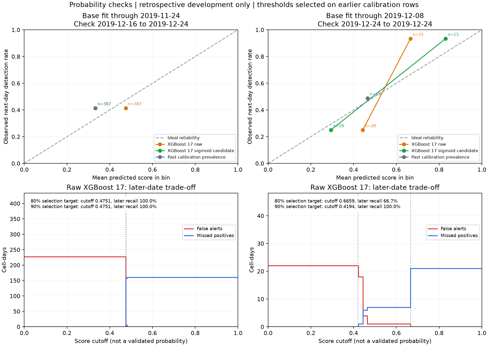

# Probability reliability and provisional research thresholds

Do not adopt sigmoid. Available temporal support and held-later improvements do not meet the project evidence gate. Retain raw research scores; trustworthy probability percentages remain unestablished.

The final holdout remains sealed. No reliable probability percentages or operational alert thresholds have been established.

## Fixed chronological designs

| Scenario | Base fit ends | Base positives | XGB 16 / 17 trees | Calibration feature dates | Calibration days / positives | Assessment feature dates | Assessment days / positives |
| --- | --- | ---: | --- | --- | --- | --- | --- |
| earlier_model_week_calibration | 2019-11-24 | 6 | 1 / 1 | 2019-12-02 to 2019-12-08 | 7 / 100 | 2019-12-16 to 2019-12-24 | 9 / 160 |
| recent_model_single_day_calibration | 2019-12-08 | 143 | 6 / 8 | 2019-12-16 to 2019-12-16 | 1 / 20 | 2019-12-24 to 2019-12-24 | 1 / 21 |

Every target is the following UTC day. Seven calendar gap days separate fitting from calibration and calibration from assessment. Inner early stopping also uses past observations with its own gap. The base model is not refitted after calibration. The second assessment overlaps the first and is not independent replication.

## Calibration decision

Supported comparison windows: 1. Supported windows improving both Brier and log loss over raw scores and past-calibration prevalence: 0. Disjoint improved windows: 0; project gate requires 2.

These support counts are project heuristics, not proof of calibration. The recent one-day split cannot support adoption. Full policy: [draft research policy](draft_probability_policy.json).

## earlier_model_week_calibration

### Held-later probability diagnostics

| Model | AP | Mean score | Observed rate | Brier | Log loss | Binned gap |
| --- | ---: | ---: | ---: | ---: | ---: | ---: |
| Logistic 16 raw | 0.3498 | 38.6% | 41.3% | 0.4347 | 2.4334 | 0.3900 |
| Logistic 17 raw | 0.5385 | 48.6% | 41.3% | 0.2978 | 2.2708 | 0.2640 |
| XGBoost 16 raw | 0.4119 | 47.5% | 41.3% | 0.2464 | 0.6858 | 0.0618 |
| XGBoost 17 raw | 0.4119 | 47.5% | 41.3% | 0.2464 | 0.6858 | 0.0618 |
| XGBoost 17 sigmoid candidate | 0.4134 | 33.2% | 41.3% | 0.2491 | 0.6924 | 0.0812 |
| Past calibration prevalence | 0.4134 | 33.2% | 41.3% | 0.2491 | 0.6924 | 0.0812 |
| Persistence | 0.7056 | 40.1% | 41.3% | 0.1783 | N/A | 0.1783 |

Lower Brier/log loss indicates better overall probability predictions; neither metric isolates calibration alone. Binned gap is a descriptive weighted absolute difference, sensitive to binning.

### Held-later rows without current detections

| Model | AP | Mean score | Observed rate | Brier | Log loss | Binned gap |
| --- | ---: | ---: | ---: | ---: | ---: | ---: |
| Logistic 16 raw | 0.1376 | 37.0% | 15.9% | 0.3322 | 1.7541 | 0.3244 |
| Logistic 17 raw | 0.1369 | 24.7% | 15.9% | 0.2961 | 1.7227 | 0.2861 |
| XGBoost 16 raw | 0.1590 | 47.5% | 15.9% | 0.2338 | 0.6607 | 0.3158 |
| XGBoost 17 raw | 0.1590 | 47.5% | 15.9% | 0.2338 | 0.6607 | 0.3158 |
| XGBoost 17 sigmoid candidate | 0.1595 | 33.2% | 15.9% | 0.1639 | 0.5151 | 0.1727 |
| Past calibration prevalence | 0.1595 | 33.2% | 15.9% | 0.1639 | 0.5151 | 0.1727 |
| Persistence | 0.1595 | 0.0% | 15.9% | 0.1595 | N/A | 0.1595 |

### Recall-target policies selected only on calibration rows

| Score | Selection recall target | Cutoff | Actual selection recall | Later recall | Later precision | Later TP | Later FP | Later FN | Later alerts/day |
| --- | ---: | ---: | ---: | ---: | ---: | ---: | ---: | ---: | ---: |
| XGBoost 17 raw | 80% | 0.47512320 | 100.0% | 100.0% | 41.3% | 160 | 227 | 0 | 43.00 |
| XGBoost 17 raw | 90% | 0.47512320 | 100.0% | 100.0% | 41.3% | 160 | 227 | 0 | 43.00 |
| XGBoost 17 sigmoid candidate | 80% | 0.33222591 | 100.0% | 100.0% | 41.3% | 160 | 227 | 0 | 43.00 |
| XGBoost 17 sigmoid candidate | 90% | 0.33222591 | 100.0% | 100.0% | 41.3% | 160 | 227 | 0 | 43.00 |
| Persistence | N/A | 0.5 | N/A | 76.9% | 79.4% | 123 | 32 | 37 | 17.22 |

Targets apply only to selection rows, not later dates. Tied scores may force the two targets to select the same cutoff and many alerts. Use the full-precision JSON cutoff with `score >= cutoff`; the displayed decimal is rounded. No target was optimised on the later assessment.

### Same policies without current detections

| Score | Selection target | Later subset TP | FP | FN | Recall |
| --- | ---: | ---: | ---: | ---: | ---: |
| XGBoost 17 raw | 80% | 37 | 195 | 0 | 100.0% |
| XGBoost 17 raw | 90% | 37 | 195 | 0 | 100.0% |
| XGBoost 17 sigmoid candidate | 80% | 37 | 195 | 0 | 100.0% |
| XGBoost 17 sigmoid candidate | 90% | 37 | 195 | 0 | 100.0% |

### Reliability by current-detection group

| Current flag | Score | Rows | Mean score | Actual detection rate |
| --- | --- | ---: | ---: | ---: |
| 0 | XGBoost 17 raw | 232 | 47.5% | 15.9% |
| 0 | XGBoost 17 sigmoid candidate | 232 | 33.2% | 15.9% |
| 1 | XGBoost 17 raw | 155 | 47.5% | 79.4% |
| 1 | XGBoost 17 sigmoid candidate | 155 | 33.2% | 79.4% |

### Calibration-fit diagnostics (selection rows, not held-later evidence)

| Model | AP | Mean score | Observed rate | Brier | Log loss | Binned gap |
| --- | ---: | ---: | ---: | ---: | ---: | ---: |
| XGBoost 17 raw | 0.3322 | 47.5% | 33.2% | 0.2424 | 0.6779 | 0.1430 |
| XGBoost 17 sigmoid candidate | 0.3322 | 33.2% | 33.2% | 0.2219 | 0.6357 | 0.0000 |
| Past calibration prevalence | 0.3322 | 33.2% | 33.2% | 0.2219 | 0.6357 | 0.0000 |

## recent_model_single_day_calibration

### Held-later probability diagnostics

| Model | AP | Mean score | Observed rate | Brier | Log loss | Binned gap |
| --- | ---: | ---: | ---: | ---: | ---: | ---: |
| Logistic 16 raw | 0.4629 | 16.7% | 48.8% | 0.3878 | 1.1392 | 0.3640 |
| Logistic 17 raw | 0.8544 | 41.7% | 48.8% | 0.1642 | 0.5568 | 0.1224 |
| XGBoost 16 raw | 0.5903 | 45.3% | 48.8% | 0.2384 | 0.6696 | 0.0642 |
| XGBoost 17 raw | 0.8084 | 52.1% | 48.8% | 0.1928 | 0.5758 | 0.2189 |
| XGBoost 17 sigmoid candidate | 0.8084 | 48.1% | 48.8% | 0.1487 | 0.4707 | 0.0644 |
| Past calibration prevalence | 0.4884 | 46.5% | 48.8% | 0.2504 | 0.6940 | 0.0233 |
| Persistence | 0.7850 | 34.9% | 48.8% | 0.1860 | N/A | 0.1860 |

Lower Brier/log loss indicates better overall probability predictions; neither metric isolates calibration alone. Binned gap is a descriptive weighted absolute difference, sensitive to binning.

### Held-later rows without current detections

| Model | AP | Mean score | Observed rate | Brier | Log loss | Binned gap |
| --- | ---: | ---: | ---: | ---: | ---: | ---: |
| Logistic 16 raw | 0.2393 | 17.8% | 25.0% | 0.2331 | 0.7244 | 0.1759 |
| Logistic 17 raw | 0.2145 | 10.9% | 25.0% | 0.2173 | 0.6979 | 0.1566 |
| XGBoost 16 raw | 0.3121 | 44.7% | 25.0% | 0.2187 | 0.6297 | 0.1973 |
| XGBoost 17 raw | 0.2578 | 44.3% | 25.0% | 0.2244 | 0.6418 | 0.1928 |
| XGBoost 17 sigmoid candidate | 0.2578 | 29.4% | 25.0% | 0.1893 | 0.5665 | 0.0436 |
| Past calibration prevalence | 0.2500 | 46.5% | 25.0% | 0.2338 | 0.6606 | 0.2151 |
| Persistence | 0.2500 | 0.0% | 25.0% | 0.2500 | N/A | 0.2500 |

### Recall-target policies selected only on calibration rows

| Score | Selection recall target | Cutoff | Actual selection recall | Later recall | Later precision | Later TP | Later FP | Later FN | Later alerts/day |
| --- | ---: | ---: | ---: | ---: | ---: | ---: | ---: | ---: | ---: |
| XGBoost 17 raw | 80% | 0.66585684 | 80.0% | 66.7% | 93.3% | 14 | 1 | 7 | 15.00 |
| XGBoost 17 raw | 90% | 0.41938713 | 100.0% | 100.0% | 48.8% | 21 | 22 | 0 | 43.00 |
| XGBoost 17 sigmoid candidate | 80% | 0.83013683 | 80.0% | 66.7% | 93.3% | 14 | 1 | 7 | 15.00 |
| XGBoost 17 sigmoid candidate | 90% | 0.24273275 | 100.0% | 100.0% | 48.8% | 21 | 22 | 0 | 43.00 |
| Persistence | N/A | 0.5 | N/A | 66.7% | 93.3% | 14 | 1 | 7 | 15.00 |

Targets apply only to selection rows, not later dates. Tied scores may force the two targets to select the same cutoff and many alerts. Use the full-precision JSON cutoff with `score >= cutoff`; the displayed decimal is rounded. No target was optimised on the later assessment.

### Same policies without current detections

| Score | Selection target | Later subset TP | FP | FN | Recall |
| --- | ---: | ---: | ---: | ---: | ---: |
| XGBoost 17 raw | 80% | 0 | 0 | 7 | 0.0% |
| XGBoost 17 raw | 90% | 7 | 21 | 0 | 100.0% |
| XGBoost 17 sigmoid candidate | 80% | 0 | 0 | 7 | 0.0% |
| XGBoost 17 sigmoid candidate | 90% | 7 | 21 | 0 | 100.0% |

### Reliability by current-detection group

| Current flag | Score | Rows | Mean score | Actual detection rate |
| --- | --- | ---: | ---: | ---: |
| 0 | XGBoost 17 raw | 28 | 44.3% | 25.0% |
| 0 | XGBoost 17 sigmoid candidate | 28 | 29.4% | 25.0% |
| 1 | XGBoost 17 raw | 15 | 66.6% | 93.3% |
| 1 | XGBoost 17 sigmoid candidate | 15 | 83.0% | 93.3% |

### Calibration-fit diagnostics (selection rows, not held-later evidence)

| Model | AP | Mean score | Observed rate | Brier | Log loss | Binned gap |
| --- | ---: | ---: | ---: | ---: | ---: | ---: |
| XGBoost 17 raw | 0.9160 | 51.3% | 46.5% | 0.1681 | 0.5251 | 0.2963 |
| XGBoost 17 sigmoid candidate | 0.9160 | 46.5% | 46.5% | 0.0971 | 0.3530 | 0.1264 |
| Past calibration prevalence | 0.4651 | 46.5% | 46.5% | 0.2488 | 0.6907 | 0.0000 |



## Interpretation and limitations

- The base model is fitted before calibration and then kept fixed. Calibration and threshold labels never enter base fitting or tree selection, and assessment labels enter none of these fitting steps.
- Every date is a UTC feature date; the binary target is eligible satellite detection on the next day, including continuing fire, not confirmed ignition or fire severity.
- Inputs are retrospective full-feature-day weather and satellite records. Their real publication latencies are not modelled; these are research reminders rather than a real-time service.
- Both scenarios use identical rows for matched logistic/XGBoost feature sets. Scalers and class weights use base fitting rows only. The calibrator uses natural label prevalence without balanced weights.
- One fixed nondecreasing sigmoid is compared with raw scores. This is an explicitly regularised logistic recalibration on score logits, not an assertion that it is identical to sklearn's implementation or will always preserve AP; zero slope or clipping can introduce ties.
- Reliability bins show observed frequencies and sample sizes. Brier and log loss assess overall probability quality, including discrimination, and do not isolate calibration. Binned gaps depend on bin definitions and are descriptive, not certification.
- Assessment rows are excluded from each scenario's fitting but were previously reviewed in development. The scenarios overlap in assessment dates and share ongoing events; they are not independent replications or a new-season test.
- Project evidence-gate counts are transparent conservative heuristics, not universal minimum sample requirements. Calendar support alone cannot establish independent-fire-event support.
- Calibration fits and threshold selection share calibration rows and are selection results. Only subsequent assessment metrics check transfer. Do not report calibration-fit reliability as held-later reliability.
- Recall targets of 80% and 90% were requested for parallel research comparison. Cutoffs minimise selection-row alerts subject to that target, retain ties, and may miss the target later. No false-alarm price or missed-fire cost is invented.
- The assessment sweep includes a fixed grid, observed score transitions and previously selected cutoffs to show exact stepwise trade-offs. No policy cutoff is reselected using assessment answers, including on the no-current-detection subset.
- No dates or labels were changed, including the target-date 22 December zero-detection concern. All cell-day counts are distinct from independent incidents or staff requirements.
- The recent one-day calibration/one-day assessment scenario is a small transfer check, not enough evidence for an adopted calibrator or operational warning policy.
- Every local saved model is reloaded and required to reproduce its exact calibration/assessment scores. Score CSVs use float64 and 17-digit text with round-trip checks so tied-score threshold decisions are reproducible; rounded display cutoffs are not replay inputs.
- The draft policy and local artifacts are concrete candidates for a later pipeline freeze. No final-test outputs were generated and no trustworthy percentage claim is made.

## Reproduce

```powershell
.\.venv\Scripts\python.exe -m bushfire_ml.probability_experiment
```

## Primary references

- [scikit-learn: probability calibration and reliability diagrams](https://scikit-learn.org/stable/modules/calibration.html)
- [scikit-learn: threshold selection and separate tuning data](https://scikit-learn.org/stable/modules/classification_threshold.html)
