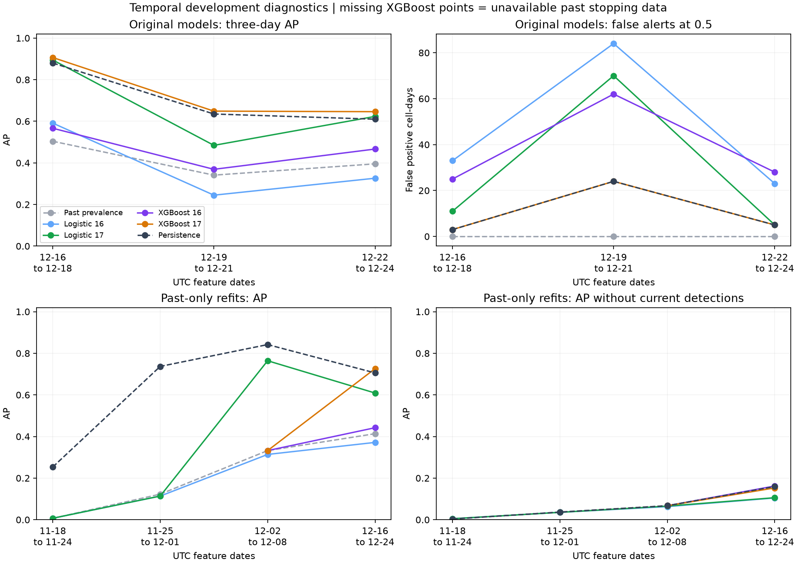

# Temporal stability diagnostics

Development only. Final holdout outcomes were not parsed or evaluated.

## Main finding

Temporal stability and a dependable improvement over persistence have not been established.

The original XGBoost 17 minus persistence AP difference is 0.0138 to 0.0361 across the 3 fixed validation blocks. Both methods have the same TP/FP/FN counts in 3 of 3 blocks at 0.5.

Past-only XGBoost fits are available for 2 of 4 outer windows, and XGBoost 17 exceeds persistence AP in 1 of those 2. Missing-class stopping windows prevent the remaining fits. The available evidence does not support a reliable cross-period advantage.

## Existing models: fixed validation slices

AP is a ranking score, not accuracy or a calibrated percentage. Original XGBoost early stopping used these validation outcomes; slices are descriptive.

| Feature-date window | Rows | Positives | Rate | Past prevalence | Logistic 16 | Logistic 17 | XGBoost 16 | XGBoost 17 | Persistence |
| --- | ---: | ---: | ---: | ---: | ---: | ---: | ---: | ---: | ---: |
| 2019-12-16 to 2019-12-18 | 129 | 65 | 50.4% | 0.5039 | 0.5911 | 0.8946 | 0.5664 | 0.9064 | 0.8799 |
| 2019-12-19 to 2019-12-21 | 129 | 44 | 34.1% | 0.3411 | 0.2448 | 0.4843 | 0.3691 | 0.6488 | 0.6350 |
| 2019-12-22 to 2019-12-24 | 129 | 51 | 39.5% | 0.3953 | 0.3263 | 0.6234 | 0.4665 | 0.6461 | 0.6100 |

### Same slices without current detections

| Feature-date window | Rows | Positives | Rate | Past prevalence | Logistic 16 | Logistic 17 | XGBoost 16 | XGBoost 17 | Persistence |
| --- | ---: | ---: | ---: | ---: | ---: | ---: | ---: | ---: | ---: |
| 2019-12-16 to 2019-12-18 | 71 | 10 | 14.1% | 0.1408 | 0.1494 | 0.1709 | 0.1612 | 0.1687 | 0.1408 |
| 2019-12-19 to 2019-12-21 | 62 | 1 | 1.6% | 0.0161 | 0.0161 | 0.0161 | 0.0161 | 0.0161 | 0.0161 |
| 2019-12-22 to 2019-12-24 | 99 | 26 | 26.3% | 0.2626 | 0.2038 | 0.2059 | 0.3114 | 0.2223 | 0.2626 |

### Daily XGBoost 17 and persistence decisions

| Feature date | Target date | Positives | XGB AP | Persistence AP | XGB TP / FP / FN | Persistence TP / FP / FN |
| --- | --- | ---: | ---: | ---: | --- | --- |
| 2019-12-16 | 2019-12-17 | 20 | 0.9210 | 0.8930 | 16 / 0 / 4 | 16 / 0 / 4 |
| 2019-12-17 | 2019-12-18 | 22 | 0.8758 | 0.8294 | 18 / 2 / 4 | 18 / 2 / 4 |
| 2019-12-18 | 2019-12-19 | 23 | 0.9267 | 0.9181 | 21 / 1 / 2 | 21 / 1 / 2 |
| 2019-12-19 | 2019-12-20 | 22 | 0.9546 | 0.9565 | 22 / 1 / 0 | 22 / 1 / 0 |
| 2019-12-20 | 2019-12-21 | 22 | 0.9778 | 0.9344 | 21 / 1 / 1 | 21 / 1 / 1 |
| 2019-12-21 | 2019-12-22 | 0 | N/A | N/A | 0 / 22 / 0 | 0 / 22 / 0 |
| 2019-12-22 | 2019-12-23 | 15 | 0.3767 | 0.3488 | 0 / 0 / 15 | 0 / 0 / 15 |
| 2019-12-23 | 2019-12-24 | 15 | 0.6597 | 0.6308 | 11 / 4 / 4 | 11 / 4 / 4 |
| 2019-12-24 | 2019-12-25 | 21 | 0.8768 | 0.7850 | 14 / 1 / 7 | 14 / 1 / 7 |

## Past-only forward windows

Settings are inherited from the original model configurations. Select XGBoost length on past inner data, then refit with that fixed length on the same past rows as logistic. Outer outcomes never select trees. Windows were specified after development coverage and original scores were known, so this is retrospective development evidence.

| Outer feature dates | Inner fitting end (positives) | Inner stopping dates (positives) | Refit end (positives) | XGB 16 / 17 selected trees |
| --- | --- | --- | --- | --- |
| 2019-11-18 to 2019-11-24 | 2019-10-27 (4) | 2019-11-04 to 2019-11-10 (0) | 2019-11-10 (4) | unavailable / unavailable |
| 2019-11-25 to 2019-12-01 | 2019-11-03 (4) | 2019-11-11 to 2019-11-17 (0) | 2019-11-17 (4) | unavailable / unavailable |
| 2019-12-02 to 2019-12-08 | 2019-11-10 (4) | 2019-11-18 to 2019-11-24 (2) | 2019-11-24 (6) | 1 / 1 |
| 2019-12-16 to 2019-12-24 | 2019-11-24 (6) | 2019-12-02 to 2019-12-08 (100) | 2019-12-08 (143) | 6 / 8 |

### Forward-window AP

| Feature-date window | Rows | Positives | Rate | Past prevalence | Logistic 16 | Logistic 17 | XGBoost 16 | XGBoost 17 | Persistence |
| --- | ---: | ---: | ---: | ---: | ---: | ---: | ---: | ---: | ---: |
| 2019-11-18 to 2019-11-24 | 301 | 2 | 0.7% | 0.0066 | 0.0070 | 0.0070 | N/A | N/A | 0.2533 |
| 2019-11-25 to 2019-12-01 | 301 | 37 | 12.3% | 0.1229 | 0.1135 | 0.1137 | N/A | N/A | 0.7369 |
| 2019-12-02 to 2019-12-08 | 301 | 100 | 33.2% | 0.3322 | 0.3138 | 0.7641 | 0.3322 | 0.3322 | 0.8418 |
| 2019-12-16 to 2019-12-24 | 387 | 160 | 41.3% | 0.4134 | 0.3716 | 0.6090 | 0.4422 | 0.7260 | 0.7056 |

### Forward-window AP without current detections

| Feature-date window | Rows | Positives | Rate | Past prevalence | Logistic 16 | Logistic 17 | XGBoost 16 | XGBoost 17 | Persistence |
| --- | ---: | ---: | ---: | ---: | ---: | ---: | ---: | ---: | ---: |
| 2019-11-18 to 2019-11-24 | 299 | 1 | 0.3% | 0.0033 | 0.0048 | 0.0047 | N/A | N/A | 0.0033 |
| 2019-11-25 to 2019-12-01 | 273 | 10 | 3.7% | 0.0366 | 0.0355 | 0.0354 | N/A | N/A | 0.0366 |
| 2019-12-02 to 2019-12-08 | 208 | 14 | 6.7% | 0.0673 | 0.0630 | 0.0654 | 0.0673 | 0.0673 | 0.0673 |
| 2019-12-16 to 2019-12-24 | 232 | 37 | 15.9% | 0.1595 | 0.1046 | 0.1059 | 0.1621 | 0.1529 | 0.1595 |

N/A means a missing-class inner window prevented fitting, or AP is undefined because the evaluation subset has no positives. Consult JSON for the exact reason and counts. No unavailable window is silently discarded.

### Diagnostic decisions at 0.5

| Window | Model | TP | FP | FN | Precision | Recall | Brier |
| --- | --- | ---: | ---: | ---: | ---: | ---: | ---: |
| 2019-11-18 to 2019-11-24 | Past prevalence | 0 | 0 | 2 | 0.0% | 0.0% | 0.0066 |
| 2019-11-18 to 2019-11-24 | Logistic 16 | 0 | 0 | 2 | 0.0% | 0.0% | 0.0069 |
| 2019-11-18 to 2019-11-24 | Logistic 17 | 0 | 0 | 2 | 0.0% | 0.0% | 0.0069 |
| 2019-11-18 to 2019-11-24 | Persistence | 1 | 1 | 1 | 50.0% | 50.0% | 0.0066 |
| 2019-11-25 to 2019-12-01 | Past prevalence | 0 | 0 | 37 | 0.0% | 0.0% | 0.1228 |
| 2019-11-25 to 2019-12-01 | Logistic 16 | 0 | 0 | 37 | 0.0% | 0.0% | 0.1230 |
| 2019-11-25 to 2019-12-01 | Logistic 17 | 0 | 0 | 37 | 0.0% | 0.0% | 0.1229 |
| 2019-11-25 to 2019-12-01 | Persistence | 27 | 1 | 10 | 96.4% | 73.0% | 0.0365 |
| 2019-12-02 to 2019-12-08 | Past prevalence | 0 | 0 | 100 | 0.0% | 0.0% | 0.3316 |
| 2019-12-02 to 2019-12-08 | Logistic 16 | 1 | 10 | 99 | 9.1% | 1.0% | 0.3414 |
| 2019-12-02 to 2019-12-08 | Logistic 17 | 61 | 26 | 39 | 70.1% | 61.0% | 0.1655 |
| 2019-12-02 to 2019-12-08 | XGBoost 16 | 0 | 0 | 100 | 0.0% | 0.0% | 0.2424 |
| 2019-12-02 to 2019-12-08 | XGBoost 17 | 0 | 0 | 100 | 0.0% | 0.0% | 0.2424 |
| 2019-12-02 to 2019-12-08 | Persistence | 86 | 7 | 14 | 92.5% | 86.0% | 0.0698 |
| 2019-12-16 to 2019-12-24 | Past prevalence | 0 | 0 | 160 | 0.0% | 0.0% | 0.3966 |
| 2019-12-16 to 2019-12-24 | Logistic 16 | 92 | 140 | 68 | 39.7% | 57.5% | 0.3649 |
| 2019-12-16 to 2019-12-24 | Logistic 17 | 124 | 86 | 36 | 59.0% | 77.5% | 0.2465 |
| 2019-12-16 to 2019-12-24 | XGBoost 16 | 139 | 156 | 21 | 47.1% | 86.9% | 0.2465 |
| 2019-12-16 to 2019-12-24 | XGBoost 17 | 123 | 32 | 37 | 79.4% | 76.9% | 0.1945 |
| 2019-12-16 to 2019-12-24 | Persistence | 123 | 32 | 37 | 79.4% | 76.9% | 0.1783 |



## Interpretation constraints

- All dates in window headings are UTC feature dates. The target date is the following day.
- Existing-model daily and three-day slices reuse the original validation outcomes that selected XGBoost length. They describe variability; they are not additional independent tests.
- Forward checks select tree count on past inner stopping data, then refit that fixed count on all available past rows before the outer gap. Both algorithms use identical refitting rows and reviewed inputs. Each fold learns its own class weights and logistic scaling from those rows.
- Seven feature-date gap days precede both inner stopping and outer evaluation. Inner gaps may rejoin the later refitting population because they are past development observations. Frozen protocol embargo rows are never loaded.
- The first seven-day window ends on the last sparse-fire week; subsequent windows follow the calendar. Development label availability and original validation results were already reviewed. No claim of untouched model selection is made.
- Keep unavailable XGBoost folds and zero-positive dates visible. No positive outcomes means AP and recall are undefined, not zero; false alerts and Brier remain available.
- AP depends on prevalence. Compare models within the same window; raw AP changes across windows do not isolate model deterioration. Do not average only available XGBoost folds and call that a four-fold comparison.
- These are dependent cells and dates from one season, potentially the same ongoing fires. Ranges are descriptive, not confidence intervals or independent-event validation.
- The original target-date 22 December zero-detection concern is retained (feature date 21 December). No dates or labels are changed.
- All scores remain uncalibrated; the fixed 0.5 cutoff is diagnostic. Stability of ranking does not establish reliable percentages or a useful operational threshold.
- Only training and validation outcomes were parsed. Original model reports and frozen data remain unchanged; the final test remains sealed.

## Reproduce

```powershell
.\.venv\Scripts\python.exe -m bushfire_ml.temporal_stability
```

## Method references

- [scikit-learn: time-series cross-validation](https://scikit-learn.org/stable/modules/cross_validation.html#cross-validation-of-time-series-data)
- [XGBoost: early stopping](https://xgboost.readthedocs.io/en/stable/python/sklearn_estimator.html#early-stopping)
