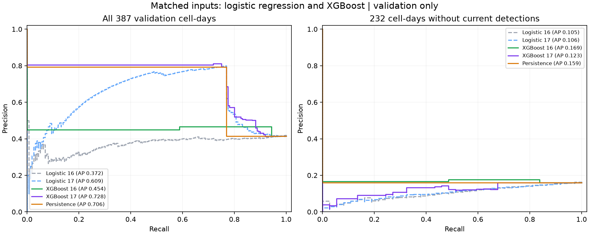

# XGBoost development comparison

Validation only; the final temporal test remains sealed.

Training rows: 6,837. Validation rows: 387 over 9 UTC feature dates.

## Fixed diagnostic threshold: 0.5

| Model | AP | Precision | Recall | TP | FP | FN | Brier |
| --- | ---: | ---: | ---: | ---: | ---: | ---: | ---: |
| Logistic 16 | 0.3716 | 39.66% | 57.50% | 92 | 140 | 68 | 0.3649 |
| Logistic 17 | 0.6090 | 59.05% | 77.50% | 124 | 86 | 36 | 0.2465 |
| XGBoost 16 | 0.4535 | 44.98% | 58.75% | 94 | 115 | 66 | 0.2484 |
| XGBoost 17 | 0.7283 | 79.35% | 76.88% | 123 | 32 | 37 | 0.1696 |
| Persistence | 0.7056 | 79.35% | 76.88% | 123 | 32 | 37 | 0.1783 |

## No current detection subset

| Model | AP | Precision | Recall | TP | FP | FN | Brier |
| --- | ---: | ---: | ---: | ---: | ---: | ---: | ---: |
| Logistic 16 | 0.1046 | 5.79% | 18.92% | 7 | 114 | 30 | 0.4106 |
| Logistic 17 | 0.1059 | 1.82% | 2.70% | 1 | 54 | 36 | 0.2736 |
| XGBoost 16 | 0.1688 | 16.67% | 48.65% | 18 | 90 | 19 | 0.2507 |
| XGBoost 17 | 0.1228 | 0.00% | 0.00% | 0 | 0 | 37 | 0.1737 |
| Persistence | 0.1595 | 0.00% | 0.00% | 0 | 0 | 37 | 0.1595 |



## Boosting length chosen on validation

| Input set | Trees retained | Rounds evaluated | Best validation AP | Training AP at retained model |
| --- | ---: | ---: | ---: | ---: |
| XGBoost 16 | 1 | 26 | 0.4535 | 0.1030 |
| XGBoost 17 | 18 | 43 | 0.7283 | 0.8437 |

## Interpretation and limits

- Each algorithm uses the same reviewed input set and observations in its matched comparison. Logistic inputs are scaled; tree inputs are not.
- XGBoost uses the training negative/positive ratio for class emphasis, matching the relative class-weight ratio of balanced logistic regression. The objectives and regularisation are not identical.
- One prespecified shallow-tree configuration was used. Validation AP selected boosting length through early stopping, so these results are development evidence and can be optimistic.
- The stopping metric is sklearn average_precision_score, explicitly maximised. XGBoost's built-in interpolated aucpr is not silently substituted.
- Compare persistence and the no-current-detection subset, not just overall ranking or the largest score.
- The 0.5 threshold is diagnostic. No probability calibrator or operational alert threshold has been selected.
- All labels and validation dates, including the 22 December zero-detection concern, are unchanged.
- The nine validation days contain dependent observations. No independent-season or operational performance is established.
- AP depends on event prevalence. Compare algorithms on the same evaluation population; the training/validation AP difference alone is not an overfitting diagnosis.
- Additional time-aware development checks, calibration design and final pipeline freeze are still required before final-test evaluation.

## Reproduce

```powershell
.\.venv\Scripts\python.exe -m bushfire_ml.xgboost_experiment
```
